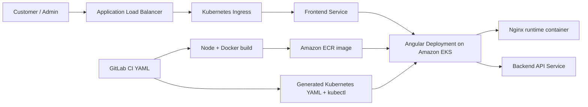

# AWS 3-Tier E-Commerce Frontend on Amazon EKS with Kubernetes YAML

[](https://kubernetes.io/)
[](https://angular.dev/)
[](https://www.docker.com/)
[](https://docs.gitlab.com/ee/ci/)

Angular frontend for a containerized 3-tier e-commerce platform deployed to Amazon EKS behind an Application Load Balancer.

> **Authoring model:** The GitLab pipeline and Kubernetes workload manifests are written in YAML. The Angular application is compiled into a multi-stage Docker image, served by Nginx, published to Amazon ECR, and deployed with generated Kubernetes YAML. AWS CLI commands are used only by the CI job as runtime deployment steps.

## Architecture



## What is authored in YAML

- `.gitlab-ci.yml` build, validation, ECR publishing, EKS access, and rollout stages
- Kubernetes Deployment, Service, and Ingress manifests generated for the frontend
- Environment-specific API URL and deployment values supplied through protected variables
- Dockerfile for the Node/Angular build and Nginx runtime image

## Features

- Angular storefront, product browsing, cart, checkout, registration, login, profile, wishlist, orders, and admin flows
- Server-side authentication and role checks; no client-side hardcoded credentials
- Multi-stage Docker build with Nginx runtime
- Kubernetes health probes and resource requests/limits
- ECR image publishing and EKS rollout verification
- Environment-based API URL configuration

## Delivery workflow

1. GitLab CI validates the frontend and container configuration.
2. The job obtains EKS access and builds the Angular/Nginx image.
3. The image is published to Amazon ECR.
4. Deployment values are rendered into Kubernetes YAML.
5. `kubectl apply` updates the EKS Deployment, Service, and Ingress.
6. Rollout status and the frontend ALB endpoint are checked.

## Technology keywords

`Kubernetes YAML` · `GitLab CI YAML` · `Amazon EKS` · `kubectl` · `Angular` · `TypeScript` · `Node.js` · `Docker` · `Nginx` · `Amazon ECR` · `AWS CLI in CI` · `Application Load Balancer`

## Local development

```bash
cd frontend-app/frontend-app
npm ci
npm start
```

The default local API URL is `/api`; configure a proxy or environment value for a separately hosted backend. Never put credentials in Angular environment files because they are bundled into the browser application.

## Related repositories

- [Kubernetes YAML backend](https://github.com/pavan-007-0/aws-3tier-cft-backend)
- [Terraform/HCL frontend](https://github.com/pavan-007-0/aws-3tier-terraform-frontend)
- [Terraform/HCL backend](https://github.com/pavan-007-0/aws-3tier-terraform-backend)
- ECS/CloudFormation repositories are documented separately under the `aws-3tier-cloudformation-ecs-*` naming convention.
