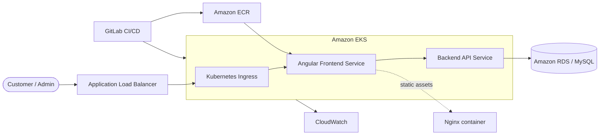

# AWS 3-Tier CFT-Track E-Commerce Frontend

[](https://angular.dev/) [](https://www.docker.com/) [](https://aws.amazon.com/)

Angular frontend for a containerized 3-tier e-commerce platform. The application is built into a multi-stage Docker image, served by Nginx, published to Amazon ECR, and deployed to Amazon EKS through AWS CLI/CloudFormation-track automation behind an internet-facing Application Load Balancer.

## Architecture



Source: [`docs/architecture.mmd`](docs/architecture.mmd).

## Features

- Angular storefront, product browsing, cart, checkout, registration, login, profile, wishlist, order-success, and admin flows.
- Admin UI uses server-side authentication and role checks rather than client-side hardcoded credentials.
- Multi-stage Docker build using Node.js and Nginx.
- Kubernetes health probes and resource requests/limits.
- ECR image publishing and EKS deployment through CI/CD.
- Environment-based API URL configuration.

## Local development

```bash
cd frontend-app/frontend-app
npm ci
npm start
```

The default local API URL is `/api`; configure a development proxy or update the environment file for a separately hosted backend. Do not put credentials in Angular environment files because they are bundled into the browser application.

## Container workflow

```bash
docker build -t ecommerce-frontend .
docker run --rm -p 8080:80 ecommerce-frontend
```

## Deployment

The pipeline validates AWS/EKS access, builds and pushes the image to ECR, applies the frontend Deployment/Service/Ingress, waits for rollout, and reports the ALB hostname. Set `AWS_DEFAULT_REGION`, `CLUSTER_NAME`, `FRONTEND_REPO`, `IMAGE_TAG`, and backend integration values as protected CI/CD variables.

## Security and operations

Use short-lived AWS credentials, least-privilege IAM, immutable image tags, HTTPS/TLS at the load balancer, secure response headers, and server-side authorization for administrative operations. AWS services can incur charges.

## Related repositories

- [AWS 3-Tier CFT Backend](https://github.com/pavan-007-0/aws-3tier-cft-backend)
- [AWS 3-Tier CFT Frontend](https://github.com/pavan-007-0/aws-3tier-cft-frontend)
- [AWS 3-Tier Terraform Backend](https://github.com/pavan-007-0/aws-3tier-terraform-backend)
- [AWS 3-Tier Terraform Frontend](https://github.com/pavan-007-0/aws-3tier-terraform-frontend)
